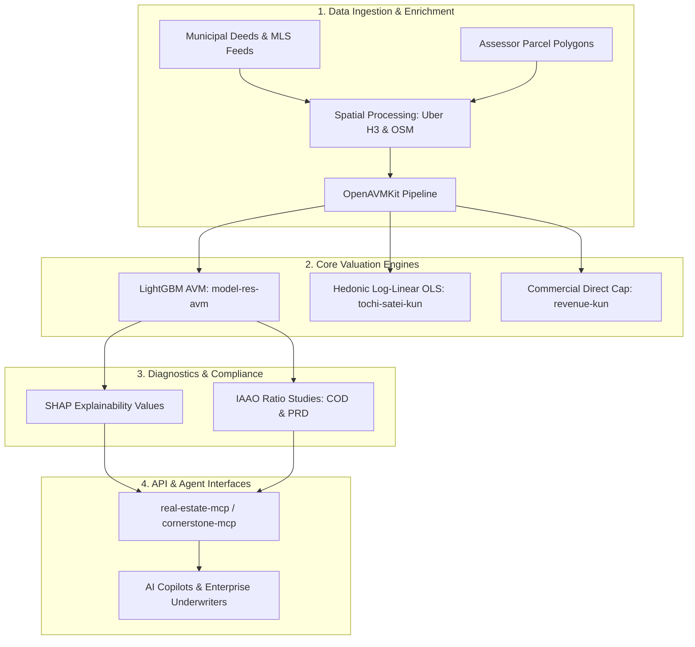

# 🏢 Awesome Strategic Real Estate Valuation Models

**Curated ecosystem of enterprise SaaS platforms, machine learning Automated Valuation Models (AVMs), mass appraisal engines, and open-source PropTech analytics.**

  
  
  
  
  
  

---

## 📌 Introduction & Overview

**Strategic Real Estate Valuation Models** combine mathematical finance, spatial statistics, machine learning, and automated data pipelines to evaluate residential and commercial real estate assets. These technologies power institutional mortgage underwriting, municipal property tax assessments, commercial asset portfolio acquisitions, and consumer PropTech experiences.

This curated list tracks:
- 🏛️ **Enterprise SaaS & Data Solutions**: Industry-standard commercial real estate (CRE) platforms, institutional data feeds, and appraisal suites.
- 💻 **Open-Source Codebases & AVM Repositories**: Self-hosted libraries, municipal appraisal systems, hedonic regressions, and agentic Model Context Protocol (MCP) servers.
- 📐 **Methodologies**: From LightGBM and spatial hedonic regression to Discounted Cash Flow (DCF) modeling and reinforcement learning.

---

## 📑 Table of Contents

- [🌐 Sector Overview & Market Dynamics](#-sector-overview--market-dynamics)
- [💼 SaaS & Enterprise Valuation Platforms](#-saas--enterprise-valuation-platforms)
- [💻 Open-Source GitHub Projects & AVM Frameworks](#-open-source-github-projects--avm-frameworks)
- [🏗️ Architectural Blueprint: Building a Self-Hosted Stack](#️-architectural-blueprint-building-a-self-hosted-stack)
- [📖 Core Concepts & Terminology](#-core-concepts--terminology)
- [📈 Star History](#-star-history)
- [🤝 How to Contribute](#-how-to-contribute)
- [⚖️ Disclaimer](#️-disclaimer)

---

## 🌐 Sector Overview & Market Dynamics

- **Market Size & Trajectory**: The global **Automated Valuation Model (AVM) and Real Estate Valuation Software** market is valued at approximately **$3.8 Billion to $4.5 Billion** and is projected to expand to **$9.6 Billion by 2034**, demonstrating a strong Compound Annual Growth Rate (**CAGR of ~10.8%**). Catalysts include automated appraisal waivers by GSEs (Fannie Mae & Freddie Mac), nationwide geospatial indexing, and instant digital mortgage origination.
- **Fragmentation & Competitive Landscape**: The sector displays a **moderately fragmented hybrid structure** characterized by a distinctive barbell distribution:
  - *Consolidated Enterprise Moats (Core Conglomerates)*: A handful of heavyweight conglomerates (e.g., **CoStar Group**, **RealPage**, **CoreLogic**, and **Altus Group**) dominate baseline public records, deeds, tax assessments, and MLS feeds. Proprietary historical data depth creates strong barriers to entry in institutional underwriting and banking compliance.
  - *High-Growth Fragmented Layer (Specialized PropTech & AI)*: A dynamic, fragmented ecosystem of agile startups and open-source models thrives across specialized verticals — including automated commercial underwriting, explainable white-box AVMs (SHAP/LightGBM), municipal mass appraisal toolkits, and agentic LLM/MCP protocols.

---

## 💼 SaaS & Enterprise Valuation Platforms

The table below catalogs leading commercial and residential real estate valuation platforms, **sorted in descending order by company size** (market capitalization, private equity acquisition valuation, or enterprise scale).

| 🏢 Platform | 💰 Company Size (Valuation / Revenue) | 🎯 Core Valuation Focus | 🏷️ Specific Starting Price | ⏱️ Specific Free Tier / Trial Limits |
|:---|:---|:---|:---|:---|
| **[CoStar](https://www.costar.com/)** | **$32.0 Billion** Market Cap (NASDAQ: CSGP, ~$2.5B ARR) | Commercial property sales comps, lease intelligence, Cap Rate tracking, and portfolio re-valuation | **$350 – $600 /user/month** (Annual contract required; entry packages typically start at $4,200 – $7,200/seat/year) | **No free tier**; 0-day self-serve trial (Evaluation strictly via scheduled 1-on-1 live sales demo) |
| **[RealPage](https://www.realpage.com/)** | **$10.2 Billion** Acquisition (Thoma Bravo; ~$1.0B+ ARR) | Multifamily revenue management (YieldStar/AI Revenue), asset cash-flow forecasting & expense modeling | **$1.00 – $5.00 /unit/month** residential (or $10/mo per 10k sq. ft. commercial; ~$250/mo minimum portfolio floor) | **No free tier**; 0-day self-serve trial (Requires enterprise sales demo; sandbox trial restricted to contracted integration partners) |
| **[CoreLogic (Cotality)](https://www.corelogic.com/)** | **$6.0 Billion** Acquisition (Stone Point / Insight; ~$1.7B ARR) | National residential AVMs (Total Home Value X), property parcel risk, deed records & mortgage data feeds | **$300 – $500 /month** minimum data tier (Annual API/data commitments start from ~$3,600 – $6,000/year) | **No free-forever tier**; 7-day trial available through RP Data partner portals (up to 10 property title searches; 0-day direct API trial) |
| **[Altus Group (ARGUS Enterprise)](https://www.altusgroup.com/)** | **$1.5 Billion** Market Cap (TSX: AIF; ~$570M USD ARR) | Institutional commercial DCF valuation, lease modeling, sensitivity testing & portfolio underwriting | **$3,000 – $5,000 /seat/year** (Billed annually; equivalent to ~$250 – $416/month per seat) | **No free tier**; 0-day self-serve trial (Requires scheduled sales consultation; 30-day non-commercial academic license for students) |
| **[ATTOM Data Solutions](https://www.attomdata.com/)** | **~$900 Million** Valuation (Lovell Minnick; ~$120M+ ARR) | Nationwide property data warehouse (155M+ parcels), tax assessor records, deeds, and automated AVMs | **$499 /year** for Property Navigator single-seat ($41.58/mo equivalent; Developer API starts at $250/month) | **7-day free trial** on Property Navigator (quota capped at 200 property reports); 30-day trial for API (up to 1,000 test requests) |
| **[HouseCanary](https://www.housecanary.com/)** | **$500 Million** Valuation ($130M+ raised) | AI residential AVM, predictive home price forecasting, CanaryAI copilot & Property Explorer | **$19 /month** (Basic Tier, billed annually at $190/yr; Pro tier at $79/mo; Teams at $165.83/mo) | **No free-forever tier**; 7-day free trial upon demo request (Includes up to 2 custom valuation reports and CanaryAI access) |
| **[Cherre](https://cherre.com/)** | **$350 Million** Valuation ($75M+ raised) | Enterprise real estate data connection layer, GraphQL entity resolution & portfolio valuation pipeline | **$10,000 /month** (Base enterprise platform data license starts at $120,000/year; tailored for $200M+ AUM portfolios) | **No free tier**; 14-day to 30-day guided enterprise Proof-of-Concept (PoC) upon qualified sales evaluation |
| **[Dealpath](https://www.dealpath.com/)** | **$220 Million** Valuation ($64M+ raised) | Institutional CRE deal pipeline management, investment underwriting, screening & portfolio analysis | **$1,000 – $1,250 /seat/year** (Minimum organizational commitments typically start at ~$10,000 – $15,000/year) | **No free tier**; 0-day self-serve trial (Requires 1-on-1 enterprise demo; custom sandbox environment provided during sales pilot) |
| **[Reonomy](https://www.reonomy.com/)** | **$201.5 Million** Acquisition (by Altus Group) | Commercial property ownership intelligence (piercing LLCs), debt/mortgage data & tax parcel analytics | **$400 /month** (Billed annually at $4,800/yr; or $500/month month-to-month, includes 1,000 monthly data exports) | **No free-forever tier**; 7-day free evaluation trial for qualified CRE pros (unlimited web searches, 10 property export cap) |
| **[Bowery Valuation](https://boweryvaluation.com/)** | **$175 Million** Valuation ($66M+ raised) | Tech-enabled commercial appraisal platform, automated comparable extraction & certified appraiser reports | **$2,500 – $4,500 /appraisal report** (Tech-enabled professional appraisal service fee structure per commercial asset) | **No free tier**; 0-day trial (Full-service appraisal engagement; 1 sample valuation report walkthrough upon intake consultation) |
| **[Skyline AI](https://www.skyline.ai/)** | **$100 Million** Acquisition (by JLL Technologies) | Deep neural network property forecasting, multifamily deal sourcing & institutional asset repricing | **$15,000 – $25,000+ /year** (Integrated into JLL Technologies institutional advisory and valuation engagements) | **No free tier**; 0-day trial (Confidential institutional deployment; evaluation only through JLL CRE advisory consultations) |
| **[Enodo](https://www.enodo.com/)** | **$35 Million** Acquisition (by Walker & Dunlop) | Automated multifamily rent roll parsing, amenity value forecasting & predictive underwriting | **$299 /month** (Historical platform subscription; currently succeeded by HelloData.ai starting at $199/month) | **No free tier**; 14-day free trial historically (5 property models; succeeded by HelloData 7-day / 3-building trial) |
| **[RentCast](https://rentcast.io/)** | **~$10 Million** Valuation (~$1.5M+ ARR) | Real-time rent estimates, rental comps, nationwide residential AVM API, and cash-flow investment analysis | **$12 /month** (Pro plan billed annually at $144/yr; or $19/mo; API Developer tiers start at $19/month) | **Free forever plan** ($0/mo with basic property data & rent estimates with portfolio caps); 50 free API calls/mo; 14-day Pro trial |

---

## 💻 Open-Source GitHub Projects & AVM Frameworks

Open-source real estate valuation repositories, mass appraisal codebases, and property intelligence tools, **sorted in descending order by GitHub star count**.

1. **[Advanced-House-Price-Prediction-](https://github.com/krishnaik06/Advanced-House-Price-Prediction-)**   
   Comprehensive machine learning lifecycle pipeline for residential property valuation. Features detailed exploratory data analysis (EDA), handling skewed feature distributions via logarithmic transforms, feature selection via Lasso regression, and advanced multi-model benchmarking (Ridge, ElasticNet, Random Forest, XGBoost) on housing datasets.

2. **[house-price-prediction](https://github.com/Shreyas3108/house-price-prediction)**   
   End-to-end comparative property valuation project comparing Gradient Boosting Regressors, Ordinary Least Squares (OLS), and Random Forest architectures to evaluate feature coefficients and maximize valuation accuracy across regional home sales.

3. **[rent-or-buy.homes](https://github.com/zebangeth/rent-or-buy.homes)**   
   Modern full-stack TypeScript and React financial model comparing long-term property acquisition equity growth against rental market trajectories. Incorporates mortgage amortization schedules, inflation, opportunity cost of capital, and regional home appreciation curves.

4. **[machine-learning-regression](https://github.com/agrawal-priyank/machine-learning-regression)**   
   Algorithmic implementation of fundamental property price prediction regression models in Python. Explores polynomial regressions, Ridge, Lasso, and K-Nearest Neighbors (KNN) regressors with custom gradient descent loss optimization for real estate pricing datasets.

5. **[openavmkit](https://github.com/larsiusprime/openavmkit)**   
   Free and open-source Python library for mass appraisal and automated valuation modeling from the Center for Land Economics. Includes spatial feature enrichment from OpenStreetMap, hedonic regressions, parcel polygon geometry calculations, building footprint imputation, and IAAO assessment ratio testing. Released under GPL-3.0.

6. **[model-res-avm](https://github.com/ccao-data/model-res-avm)**   
   Production automated valuation model for residential properties maintained by the Cook County Assessor's Office (Chicago, IL). Employs LightGBM within R Tidymodels with SHAP explainability values, comparable sales generation, Quarto diagnostic reports, and direct export to the official county tax assessment system of record.

7. **[real-estate-mcp](https://github.com/agentic-ops/real-estate-mcp)**   
   Model Context Protocol (MCP) server for autonomous AI real estate agents with 13 valuation and analysis tools, including comparative market analysis (CMA), mortgage calculations, and live API integrations with Census Bureau, Walk Score, FEMA, and FRED economic data.

8. **[House-price-prediction](https://github.com/AshiteshSingh/House-price-prediction)**   
   Hybrid machine learning valuation engine fusing gradient boosting trees (XGBoost, LightGBM, CatBoost) with Deep Neural Network (DNN) architectures for non-linear residential property valuation.

9. **[Housing_Price_Prediction](https://github.com/bibek376/Housing_Price_Prediction)**   
   End-to-end data pipeline with web scrapers, automated spatial geocoding, feature extraction, and ensemble regression for localized real estate price estimations.

10. **[Real-Estate-Price-Prediction-Using-Machine-Learning-Project](https://github.com/Vatshayan/Real-Estate-Price-Prediction-Using-Machine-Learning-Project)**   
    Production-style web application for real estate price forecasting combining Python Flask, Scikit-Learn regression pipelines, and an interactive frontend with location-based pricing heuristics.

11. **[ML-based-AVM](https://github.com/Linhkust/ML-based-AVM)**   
    Research-grade automated residential property valuation framework featuring sequential feature selection, genetic algorithm hyperparameter tuning, and comparative testing across Random Forest, SVR, and XGBoost with explainability analysis.

12. **[tochi-satei-kun (土地価格査定クン)](https://github.com/signal-yield/tochi-satei-kun)**   
    Open-source "white-box" AVM developed by Signal Yield Advisory (Apache 2.0). Employs hedonic log-linear OLS regression calibrated dynamically per municipality using Japanese MLIT official transaction price datasets and land price GeoJSON, with seamless Claude Code/Skill integration.

13. **[real-estate-avm](https://github.com/dmai287/real-estate-avm)**   
    Multi-metro machine learning AVM trained on property datasets across Chicago, Dallas, and Denver. Features data cleaning, feature engineering, multiple regression algorithms (Linear, Random Forest, XGBoost), evaluation metrics (RMSE, MAE, R²), and RESTful API endpoints.

14. **[revenue-kun (収益還元クン)](https://github.com/signal-yield/revenue-kun)**   
    Open-source commercial direct capitalization valuation engine parsing rent rolls (PDF/CSV) to generate standardized DCF / net operating income valuation spreadsheets with Docker support.

15. **[ames-housing-ml](https://github.com/Julian-Rincon/ames-housing-ml)**   
    Autonomous valuation agent integrating XGBoost AVM (R² = 0.921, MAPE = 7.8%) with Reinforcement Learning (Q-learning, Double DQN) on an event-driven AWS pipeline featuring live RAG valuation tools and comparable sales distance scoring.

16. **[InvestSmart_Recommender](https://github.com/VyjayanthiPolapragada/InvestSmart_Recommender)**   
    AI-powered commercial real estate recommendation engine built on 1M+ U.S. commercial properties utilizing Sentence-BERT embeddings, geospatial nearest-neighbor search, and Random Forest deal scoring for sub-0.1s inference.

17. **[cornerstone-mcp](https://github.com/jsconiers/cornerstone-mcp)**   
    Model Context Protocol server featuring 156 real estate tools, including blended AVM valuation (RentCast + ATTOM), FEMA risk index integration, and 12 investment calculators (IRR, NPV, cap rate, Monte Carlo).

18. **[FARAD Deep-Neural-Market-Forecasting-Engine](https://github.com/FARADTechnologies/Deep-Neural-Market-Forecasting-Engine)**   
    Phased real estate market forecasting engine for Riyadh and Jeddah featuring Uber H3 geospatial indexing, hedonic linear baselines, and deep neural network valuation architectures.

19. **[realEstateValuation](https://github.com/mobius29er/realEstateValuation)**   
    Business analytics and pricing strategy tool predicting real estate transaction sale probability against local market averages, packaged with a Streamlit interface.

20. **[House_Predicition_Values](https://github.com/bilalahmed251/House_Predicition_Values)**   
    California property valuation engine with Scikit-Learn regression pipelines, logarithmic feature transforms for skewed census variables, and interactive Streamlit UI.

21. **[housing-valuation-gis](https://github.com/ApatShe/housing-valuation-gis)**   
    End-to-end mass appraisal GIS workflow on residential sales: ArcGIS geospatial extraction, OpenAVMKit integration, and IAAO assessment ratio studies.

---

## 🏗️ Architectural Blueprint: Building a Self-Hosted Stack

To build a full-featured, auditable, and self-hosted valuation platform, architects can assemble the following open-source components:

- **Data Wrangling & Parcel Geometry**: Use [`openavmkit`](https://github.com/larsiusprime/openavmkit) for spatial proximity joins, building footprint calculations, and OpenStreetMap amenities.
- **Production Assessment Engine**: Deploy [`model-res-avm`](https://github.com/ccao-data/model-res-avm) for gradient-boosted decision trees (LightGBM) with native categorical handling and SHAP value explainability.
- **Agentic Protocol Interface**: Connect models to LLMs using [`real-estate-mcp`](https://github.com/agentic-ops/real-estate-mcp) or [`cornerstone-mcp`](https://github.com/jsconiers/cornerstone-mcp) for autonomous deal appraisal and multi-factor diligence.

---

## 📖 Core Concepts & Terminology

- **AVM (Automated Valuation Model)**: A mathematical algorithm that calculates real estate property value by analyzing location, comparable sales, physical characteristics, and market trends without immediate on-site human inspection.
- **Mass Appraisal**: The process of valuing a large universe of properties (e.g., an entire county or municipality) as of a specific date using standard methodology, common data, and statistical testing (IAAO standards).
- **Hedonic Regression**: An econometric pricing model breaking down property value into individual constituent characteristics (e.g., square footage, number of bedrooms, lot size, school district score).
- **COD (Coefficient of Dispersion)**: The primary measure of assessment equity and appraisal uniformity; lower COD indicates tighter valuation consistency across properties.
- **PRD (Price-Related Differential)**: An assessment equity metric determining whether higher-value properties are appraised at higher or lower ratios than lower-value properties (identifying regressivity or progressivity).
- **DCF (Discounted Cash Flow)**: An income-approach valuation method projecting future Net Operating Income (NOI) and terminal value, discounted back to present value using a target discount rate / cap rate.

---

## 📈 Star History

---

## 🤝 How to Contribute

Contributions are warmly welcomed! To contribute:

1. 🍴 **Fork** the repository.
2. 🌿 **Create a branch** (`git checkout -b feature/add-new-avm-platform`).
3. 📝 **Add/Update entries** following the tabular format for SaaS platforms or list format with star badge for open-source repositories.
   - For SaaS: Must include specific company size, starting tier price, and exact free trial / free tier limitations.
   - For Open-Source: Include link, star badge (`style=social&color=white`), and an informative 1–2 sentence technical description.
4. 🚀 **Submit a Pull Request** with a concise explanation of the addition.

---

## ⚖️ Disclaimer

- This repository is a **community-curated index** intended for research, architectural planning, and educational purposes. Inclusion does not constitute an endorsement.
- Automated valuation models and statistical estimates do not replace certified appraisal reports required under the Uniform Standards of Professional Appraisal Practice (USPAP), International Valuation Standards (IVS), or state real estate lending regulations.
- All trademarks, logos, and brand names are the property of their respective owners.
